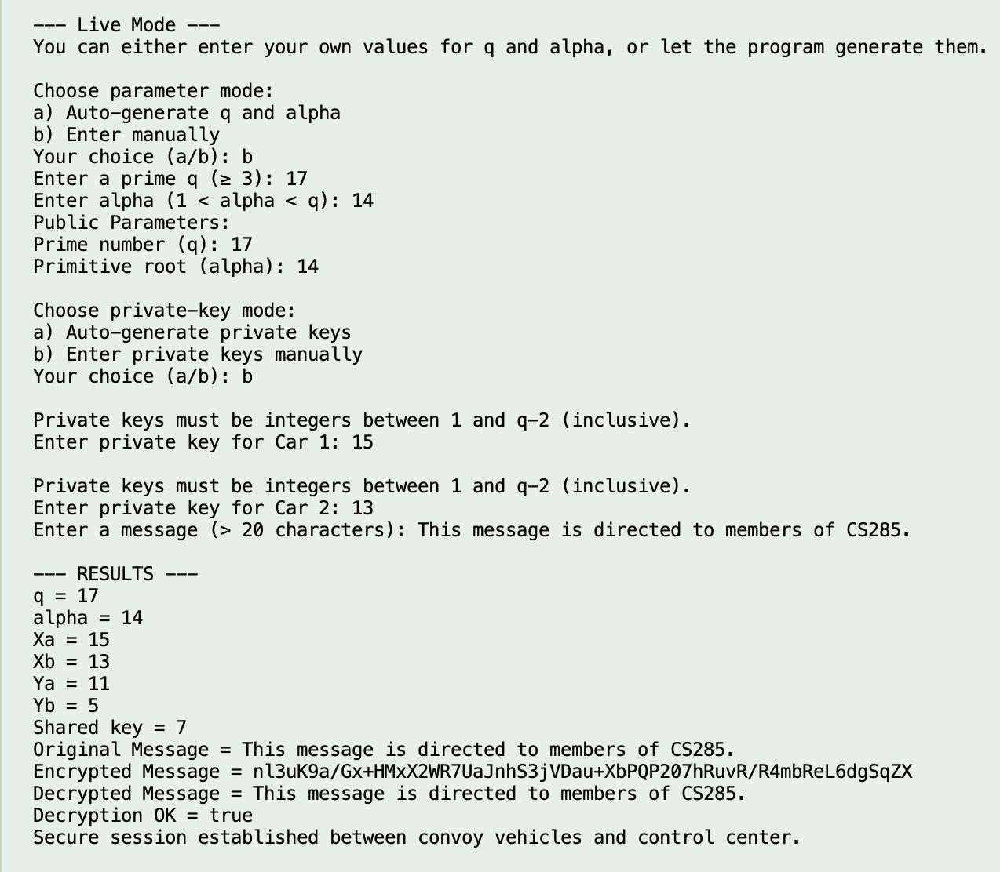
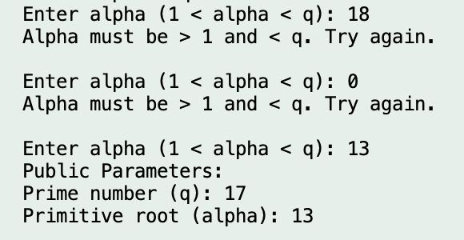
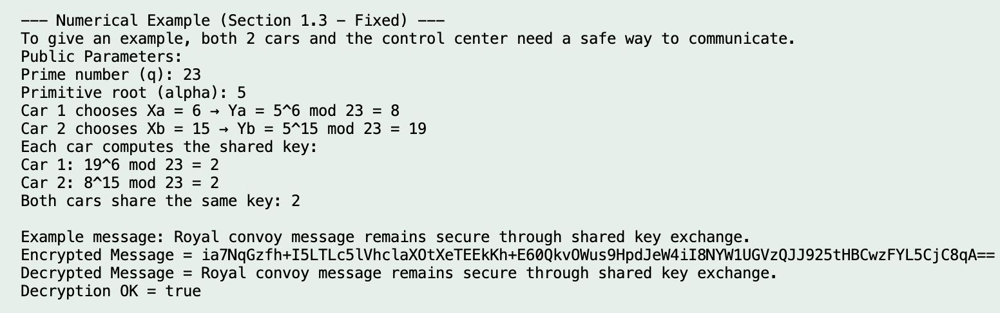
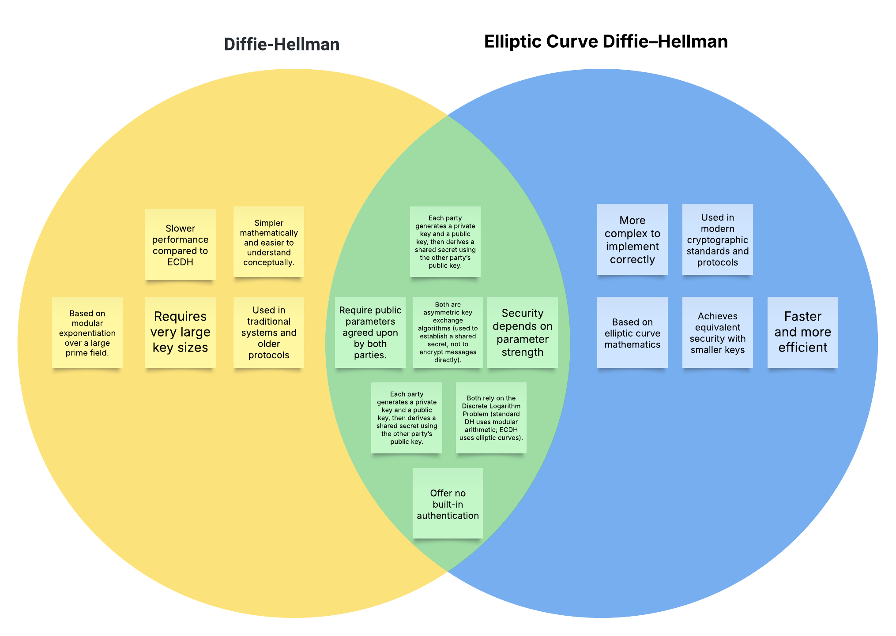

## Live mode: manual example

In manual live mode, users enter \( q \), \( \alpha \) and the message directly. The system validates each input before continuing.

After key generation and exchange, both participants derive the same shared key, then encrypt and decrypt the message successfully.

!!! note "Observation"
    Matching decrypted output confirms successful shared-key derivation and correct message flow.

## Live mode: invalid α

This case verifies input validation. If a user provides \( \alpha \) outside the valid range \( 1 < \alpha < q \), the program rejects it and asks for a valid value.

!!! tip "Validation path"
    `Validator` and `Helpers` jointly enforce numeric and range constraints before any cryptographic computation.

## Numerical example (fixed values)

This test uses small values for transparent, step-by-step verification. The values match the console output above.

| Parameter | Value |
| --- | ---: |
| Prime number \( q \) | 23 |
| Primitive root \( \alpha \) | 5 |
| Private key \( X_a \) | 6 |
| Private key \( X_b \) | 15 |
| Public key \( Y_a \) | 8 |
| Public key \( Y_b \) | 19 |
| Shared key \( K \) | 2 |

!!! success "Result verification"
    Both participants compute the same shared key, \( K = 2 \), and the message decrypts back to the original text.

## DH vs ECDH comparison

This visual comparison places the project in broader context.

!!! note "Summary"
    DH and ECDH both establish shared secrets. ECDH typically provides comparable security with smaller keys and improved efficiency.
